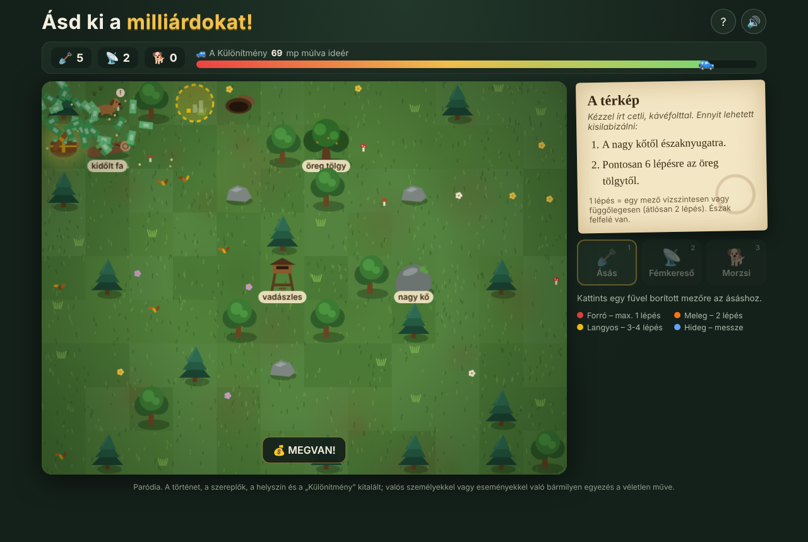
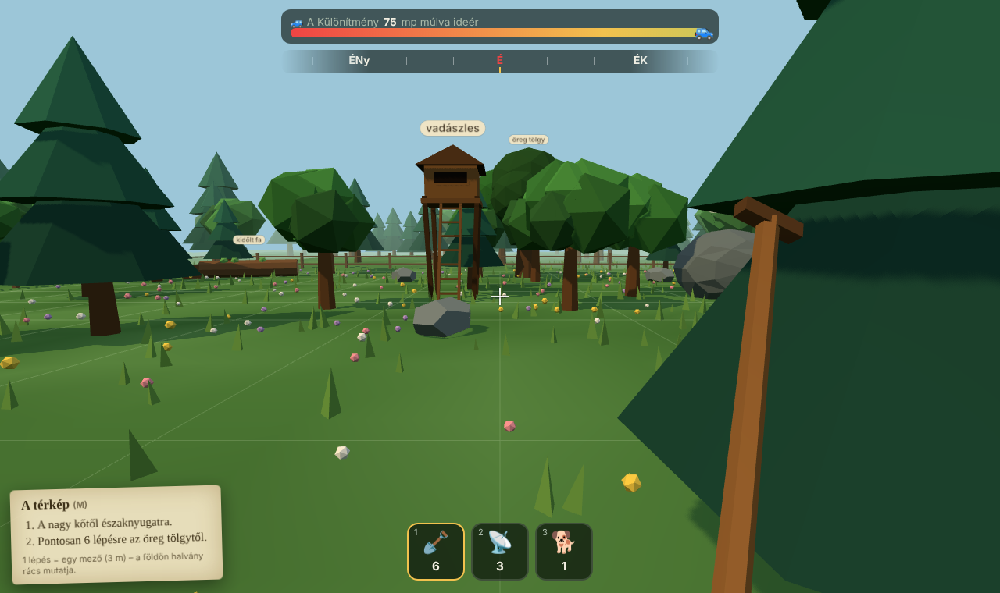
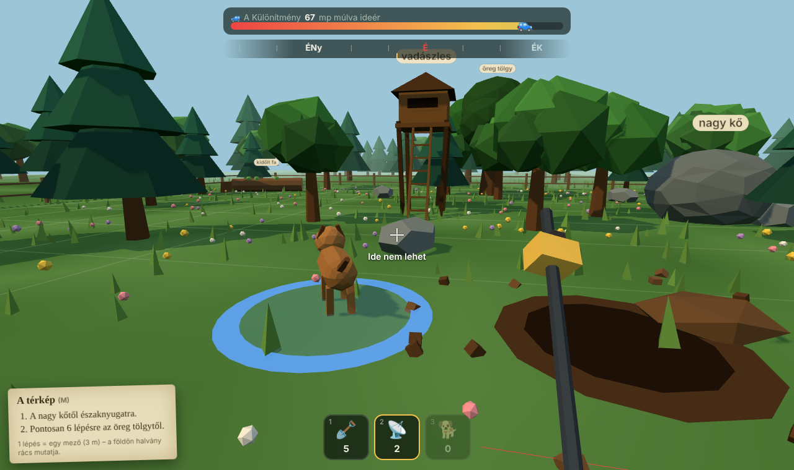
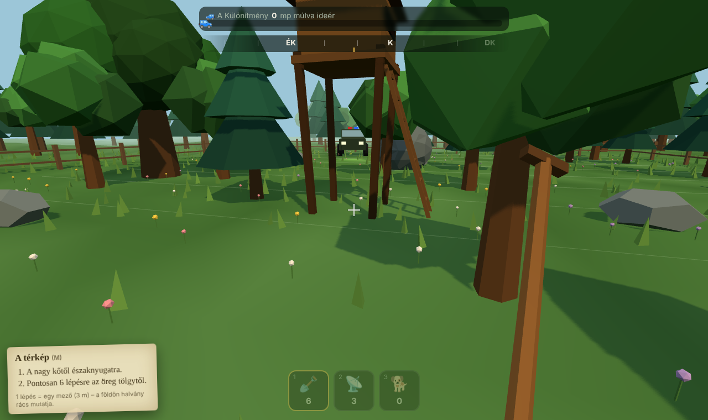
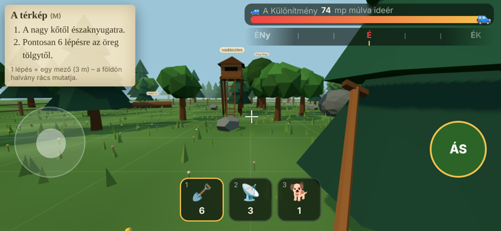

# Ásd ki a milliárdokat! 🪏💰

[](https://github.com/tibortoth8807/DigUpTheBillions/actions/workflows/deploy.yml)


**A satirical browser puzzle game (in Hungarian):** a fictional retired minister buried his "investments" in the forest.
You have his scribbled map, a shovel, a metal detector and a dog – dig up the billions before the squad's jeep arrives.

Two ways to play the **same map with the same rules**:

| 🗺️ Map view (2D) | 🌲 In the field (3D, first person) |
|---|---|
|  |  |

> 🇭🇺 *Egy kitalált nyugalmazott miniszter elásta a milliárdokat a Bükkös-erdőben. Nálad a térkép – ásd ki, mielőtt a Különítmény odaér!*
>
> **Parody.** The story, characters, place and "Különítmény" are fictional; any resemblance to real persons or events is coincidental.

## How to play

- 🗺️ The **map** gives 2–3 clues ("Pontosan 4 lépésre az öreg tölgytől", "A vadászlestől északkeletre") that narrow the forest down to a few tiles.
- 🪏 **6 digs** – every miss costs 3 seconds (noise attracts the squad).
- 📡 **3 detector readings** – hot / warm / lukewarm / cold by distance.
- 🐕 **The dog** sits down 1–2 steps from the treasure, once.
- ⏱️ **75 seconds.** Unused tools and time are worth points. Results can be shared Wordle-style (no spoilers).
- **Daily map:** everybody gets the same forest on the same day (seeded by the date).

### 3D mode

Walk the forest in first person: find the landmarks from the clues, count the steps on the ground grid, look at a tile and dig.
The detector beeps in your hand, the dog runs ahead and sits near the treasure, and in the last 15 seconds you hear the squad's siren –
if time runs out, their jeep rolls in with flashing lights and a light beam shows where the treasure was.

| Detector & digging | The squad arrives | Mobile (touch) |
|---|---|---|
|  |  |  |

Controls: **mouse** look (pointer lock; if the browser refuses it, e.g. in a sandboxed iframe, the game falls back to drag-to-look) · **WASD** walk · **Shift** run · **click / E** dig · **1-2-3** tools · **M / Tab** map · **Esc** pause (the clock stops).
On phones: virtual stick, drag to look, big **ÁS** button.

## Tech

| Area | What |
|---|---|
| Language | TypeScript (strict), no game engine, no runtime dependencies |
| 2D rendering | HTML Canvas 2D: procedurally drawn sprites (trees, landmarks, dog, chest), offscreen-rendered forest floor, particles, high-DPI aware |
| 3D rendering | **Three.js** (WebGL): every model built from primitives in code (low-poly, flat shading – no 3D asset files), instanced grass, shadows, fog, sprites for labels |
| 3D gameplay | Own first-person controller (pointer lock + touch stick), circle collisions, ground ray picking for the target tile, animated tools, particles, dog & jeep AI |
| Architecture | Both views share one rules engine (`Game`); the 3D module is **lazy-loaded** (code splitting), so the 2D game stays light |
| Procedural content | Seeded PRNG (mulberry32 + FNV-1a), forest generator, **puzzle generator that guarantees a fair puzzle** (3–7 candidate tiles, always solvable with the tools) |
| Audio | Sound effects synthesized with the Web Audio API – no audio files |
| UX | Responsive (desktop & mobile, touch), keyboard shortcuts, Web Share API / clipboard |
| Quality | Game logic separated from rendering and unit-tested with `node:test` – including 500 random maps for puzzle fairness |
| Build & deploy | Vite, GitHub Actions → GitHub Pages |

```
src/
  game/      pure logic – rng, forest, puzzle, game rules, share text (no DOM)
  render/    2D canvas renderer and sprites
  fps/       3D mode: world builder, procedural models, first-person controller
  audio.ts   Web Audio sound effects
  main.ts    UI wiring, input, game loop
tests/       node:test unit tests for the game logic
```

## Run locally

```bash
npm install
npm run dev     # http://localhost:5173
npm test        # game logic tests
npm run build   # static files in dist/
```

## Deploy

Push to `main` → the workflow tests, builds and publishes to GitHub Pages
(one-time: repository **Settings → Pages → Source: GitHub Actions**).

## Ideas

- [ ] Levels: bigger forest, night mode with flashlight, decoy maps
- [ ] 3D: terrain hills, ambient sounds (birds, wind), gamepad support
- [ ] Leaderboard for the daily map (ASP.NET Core minimal API)

## Author

**Tibor Tóth** – [LinkedIn](https://www.linkedin.com/in/tibor-t%C3%B3th-a353b38b) · More: [VulnLens](https://github.com/tibortoth8807/VulnLens) · [AccessDesk](https://github.com/tibortoth8807/AccessDesk) · [PartFinder](https://github.com/tibortoth8807/AutoWebshopPartfinder) · [TalentPulse](https://github.com/tibortoth8807/TalentPulse)
